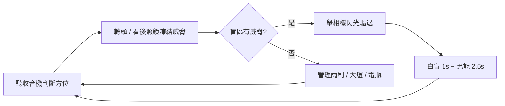

# 提案構想報告:EVIDENCE 1989: BLACK RAIN

> 依據《EVIDENCE 1989: BLACK RAIN — 16-bit 設計文件》整理 · 日期:2026-11-04
> 繼承作品:《EVIDENCE 1976》(TNDA Game Design Cycle 02)

---

## 1. 提案摘要

深夜暴風雨中,主角的旅行車拋錨在林道。玩家只有 **4 張底片**和一台**強光閃光相機**。怪物只在玩家**不看牠**時靠近。想拍清楚,就得先移開視線,而這次玩家把背後交給了黑暗的車廂。

**類型**:心理恐怖 × 時機博弈 × 資源管理 ·**風格**:1989~1992 年 16-bit(SFC / Mega Drive / PC Engine)·**平台**:瀏覽器(HTML5 Canvas + Web Audio)

## 2. 背景與問題

前作《EVIDENCE 1976》確立了核心博弈:**「貪婪與恐懼是同一個動作」**。受限於 70 年代街機技術,前作有三個瓶頸:

| 前作瓶頸 | 本提案對策 |
|---|---|
| 觀景窗像手電筒 | 玩家被關進具體的車廂,用轉頭環顧取代手電筒 |
| 玩家容易盲猜 | AM 收音機雜訊加立體聲定位,讓方位**可推理** |
| 空間感薄弱 | 4 層視差捲軸加 16-bit 暗夜調色盤 |

## 3. 核心創意

1. **視線凍結**:被注視的怪物完全靜止。視線一離開,牠就在盲區進逼。
2. **轉頭即風險**:640px 全景車廂,轉向右窗時,左側與後方就成了盲區。
3. **聽聲辨位**:收音機是聲學雷達。雜訊偏左或偏右,表示怪物在左或右。雜訊居中並伴隨蜂鳴,表示怪物在正面或後方。
4. **資源三角博弈**:電瓶、底片、電容充能互相牽制。
   - 雨刷每秒耗 0.5% 電量。
   - 大燈每秒耗 1.8% 電量,而且會激怒怪物,使牠轉向側翼包抄。
   - 閃光的代價是 1 秒白盲,加上 2.5 秒充能。
5. **雨水遮蔽**:雨刷關閉後,水膜 `rainBlur > 0.65` 時,注視判定失效。

## 4. 玩法循環



**照片評級**:距離越近,評級越高。得分 = 填充率 × 0.6 + 置中精度 × 0.4。

| 評級 | 條件 |
|---|---|
| BLURRY | `dist > 0.6` |
| SUSPICIOUS | `0.3 < dist ≤ 0.6` |
| EVIDENCE | `dist ≤ 0.3` |

## 5. 關卡進程(每晚 90 秒)

| 夜 | 主題 | 變化 | 學習 / 壓力 |
|---|---|---|---|
| 1 | 試探之夜 | 單一怪物,標準速度,從正前方、左窗、右窗輪流試探 | 教學:轉頭、聽聲辨位、雨刷與快門節奏 |
| 2 | 暴雨與車頂 | 水膜累積加快 80%,怪物加速 30%,新增攀爬車頂(4 秒內須閃光驅退) | 雨刷成為生存要素 |
| 3 | 絕境之夜 | 初始電量 75%,耗電增加 30%,雙重威脅(一側聲響誘敵,另一側盲區衝刺) | 極限資源管理 |

**勝利**:撐到 05:00,且當晚至少拍到 1 張 EVIDENCE。
**失敗**:破窗死亡,或底片耗盡且沒有證據照片。

## 6. 視聽表現

- **畫面**:320×240 邏輯解析度,整數倍放大;640px 全景;4 層視差(遠景、森林泥地、車窗、車廂)。
- **特效**:雨滴粒子、水膜模糊、雨刷扇形清空、閃光白色殘影、閃電暴露樹海剪影。
- **音效**:全程用 Web Audio 合成,不需外部素材。包含粉紅噪音雨聲、收音機超自然雜訊、`StereoPannerNode` 左右聲相、快門衝擊聲。

## 7. 技術方案

```
evidence-16bit.html (進入點)
 ├─ evidence-16bit-core.js    純邏輯(狀態機 / AI / 電瓶 / 水膜 / 評分),無 DOM,Node 可測
 ├─ evidence-16bit-render.js  Canvas 2D 視差渲染
 └─ evidence-16bit-audio.js   Web Audio 立體聲合成
tests/core-16bit.test.js      自動化單元測試
```

- **優點**:高內聚低耦合,核心邏輯可單獨測試。零外部依賴,可直接在瀏覽器執行。
- **測試範圍**:注視凍結、水膜失效邊界、電瓶耗損、閃光與評級、三夜流程。

## 8. 風險與待確認事項

| 風險 | 建議 |
|---|---|
| 難度平衡(閃光代價、怪物速度、電量) | 把數值集中成可調參數,透過試玩迭代 |
| 聲音定位是否足夠可推理 | 儘早做音訊原型,測試玩家辨位準確率 |
| 後照鏡與車頂判定的操作複雜度 | 第一夜只做教學式引導,逐步引入 |
| 單次遊玩時間短(約 4.5 分鐘共 3 夜) | 視需要加入夜間變體或分數挑戰,增加重玩性 |
| 規格內的相機位置:`panX` 範圍 0~320 與全景 640px 的對應 | 實作前統一座標定義 |

## 9. 後續步驟

1. 審閱本提案與設計文件。
2. 使用 `writing-plans` 撰寫實作計畫。
3. 先做核心邏輯與單元測試,再做渲染與音訊,最後調整平衡。
4. 完成可玩版本後進行試玩與數值調整。
